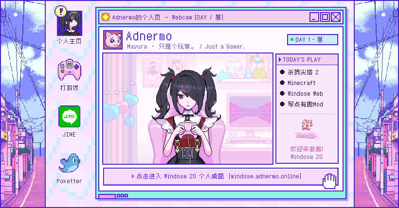
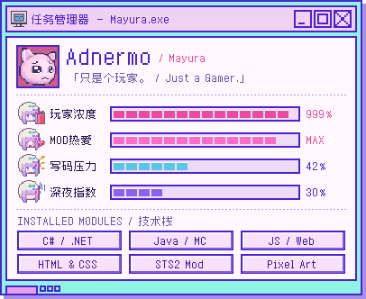
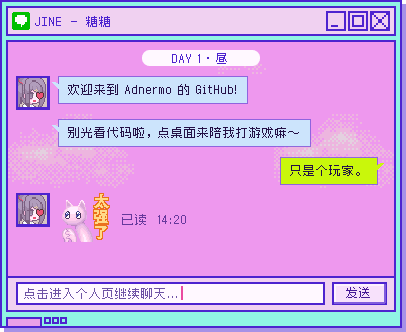
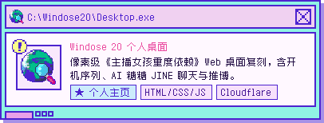
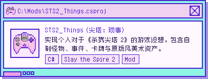
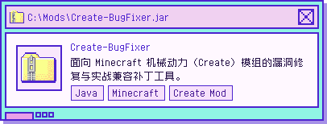
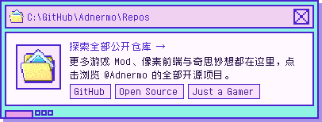

  <a href="https://windose.adnermo.online/" title="点击进入 Adnermo 的 Windose 20 个人桌面">
    <picture>
      <source media="(prefers-color-scheme: dark)" srcset="./assets/hero_dark.png">
      <source media="(prefers-color-scheme: light)" srcset="./assets/hero_light.png">
      
    </picture>
  </a>

  <a href="https://windose.adnermo.online/" title="任务管理器 — Mayura.exe · 点击进入个人桌面">
    <picture>
      <source media="(prefers-color-scheme: dark)" srcset="./assets/panel_status_dark.png">
      <source media="(prefers-color-scheme: light)" srcset="./assets/panel_status_light.png">
      
    </picture>
  </a>
  <a href="https://windose.adnermo.online/" title="JINE — 点击进入个人桌面与糖糖聊天">
    <picture>
      <source media="(prefers-color-scheme: dark)" srcset="./assets/panel_jine_dark.png">
      <source media="(prefers-color-scheme: light)" srcset="./assets/panel_jine_light.png">
      
    </picture>
  </a>

  <a href="https://windose.adnermo.online/" title="Windose 20 个人桌面 (windose.adnermo.online)">
    <picture>
      <source media="(prefers-color-scheme: dark)" srcset="./assets/card_windose_dark.png">
      <source media="(prefers-color-scheme: light)" srcset="./assets/card_windose_light.png">
      
    </picture>
  </a>
  <a href="https://github.com/Adnermo/STS2_Things" title="STS2_Things — 杀戮尖塔 2 个人 Mod">
    <picture>
      <source media="(prefers-color-scheme: dark)" srcset="./assets/card_sts2_dark.png">
      <source media="(prefers-color-scheme: light)" srcset="./assets/card_sts2_light.png">
      
    </picture>
  </a>

  <a href="https://github.com/Adnermo/Create-BugFixer" title="Create-BugFixer — Minecraft Create Mod 修复工具">
    <picture>
      <source media="(prefers-color-scheme: dark)" srcset="./assets/card_create_dark.png">
      <source media="(prefers-color-scheme: light)" srcset="./assets/card_create_light.png">
      
    </picture>
  </a>
  <a href="https://github.com/Adnermo?tab=repositories" title="浏览 Adnermo 的全部公开仓库">
    <picture>
      <source media="(prefers-color-scheme: dark)" srcset="./assets/card_repos_dark.png">
      <source media="(prefers-color-scheme: light)" srcset="./assets/card_repos_light.png">
      
    </picture>
  </a>

  <a href="https://windose.adnermo.online/" title="开始菜单 · 点击进入 windose.adnermo.online">
    <picture>
      <source media="(prefers-color-scheme: dark)" srcset="./assets/taskbar_dark.png">
      <source media="(prefers-color-scheme: light)" srcset="./assets/taskbar_light.png">
      
    </picture>
  </a>

  切换 GitHub 亮色 / 暗色主题可触发「昼 · 糖糖打游戏 / 夜 · 超天酱直播」双形态桌面 · <a href="https://windose.adnermo.online/">进入 Windose 20 个人页 ↗</a>

